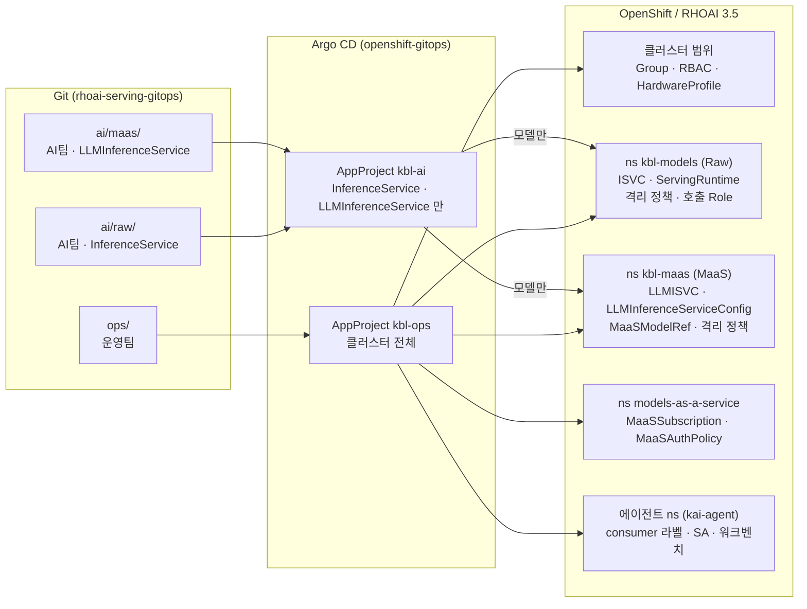
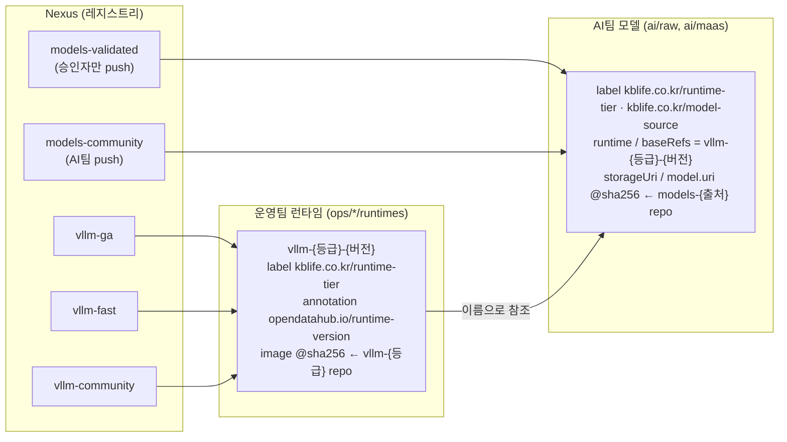
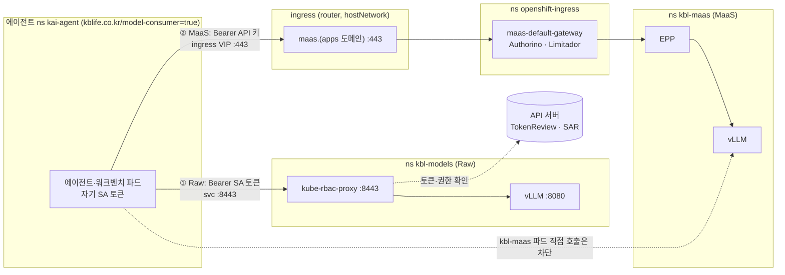
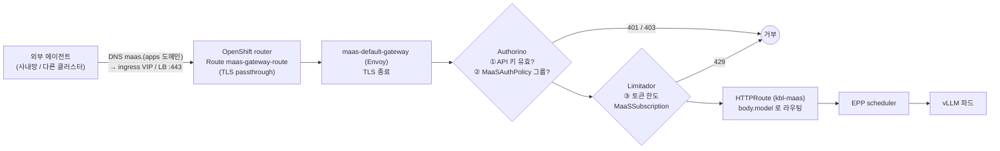
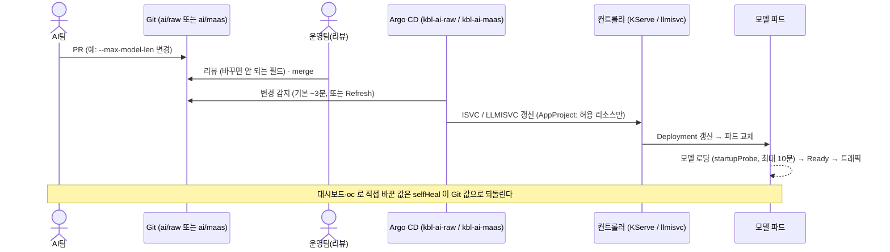

# KB Life AI 모델 서빙 GitOps (RHOAI 3.5)

RHOAI 3.5 위에서 LLM 을 **두 가지 방식(KServe RawDeployment, llm-d + MaaS)으로 함께** 서빙하는 구조와,
운영팀(ai-ops)·AI admin·AI 개발자(에이전트 개발자)가 각자 무엇을 하고, 모델을 어떻게 호출하며,
무엇을 바꾸면 배포된 모델에 어떤 일이 일어나는지 설명한다.

- 모델 이미지(ModelCar) 빌드·검증 도구는 [model-lifecycle](https://github.com/edwin-noh/model-lifecycle) 리포에 있다
- PoC(클러스터 rhoai-35, 리포 `rhoai-serving-gitops`, 브랜치 `main`)에서 검증했다.
  표기: **PoC 확인** = 실제 동작 확인, **추정** = 동작 원리상 예상(미검증), **3.5 미확인** = RHOAI 3.5 문서에 근거 없음
- 나중에 리포를 나눌 때는 `ops/`, `ai/` 를 각각 리포로 옮기고 Argo CD 의 `repoURL`/`path`/`sourceRepos` 만 바꾼다

> **PoC 클러스터 현재 상태**: GPU 1장(RTX 3060 12GB)을 **time-slicing 으로 2개**로 나눠(openshift-cluster-gitops gpu-operator
> overlay `time-sliced-2`) 소형 모델 `qwen3-1-7b` 를 **Raw 와 MaaS 로 동시에** 서빙한다 (파드당 `--gpu-memory-utilization=0.45`).
> `qwen3-4b-instruct` 는 Raw 쪽은 `serving.kserve.io/stop` 으로 정지, MaaS 쪽은 전체 주석(보관본)이다. KB Life 에서는 모델마다 GPU 를 따로 쓴다.

---

## 1. 한 장 요약

| 원칙 | 의미 | 왜 |
|---|---|---|
| **Git 이 유일한 변경 경로** | 사람은 Git 에 커밋하고, 클러스터 반영은 Argo CD 만 한다 | 변경 이력·리뷰·롤백이 Git 에 남는다. 손으로 바꾼 것은 Argo CD 가 되돌린다(selfHeal) |
| **폴더 = 책임** | `ops/` 는 운영팀(ai-ops), `ai/` 는 AI팀 | 누가 무엇을 바꿀 수 있는지 폴더만 보면 안다 |
| **이중 가드** | Argo CD AppProject 가 AI팀 폴더의 허용 리소스를 제한 + 클러스터 RBAC 는 AI팀에 조회(view)만 | AI팀이 네트워크·권한·런타임을 바꿀 수 없다 |
| **두 서빙 경로, 용도로 구분** | **Raw**: 클러스터 안 에이전트 전용, SA 토큰 / **MaaS**: 클러스터 안팎, API 키 + 토큰 한도 | 내부 호출은 단순·저지연으로, 사용자·외부 호출은 사용량 통제와 함께 |
| **이름·digest 고정** | 런타임 `vllm-<등급>-<버전>`, 이미지·모델은 `@sha256:` | 무엇이 떠 있는지 정확히 식별, 검사한 이미지 그대로 배포 |
| **모델 접근은 정책으로** | Raw: 호출자 등록(`ops/consumers`) / MaaS: 그룹별 구독·인가(`ops/maas-policy`) | "누가 어떤 모델을 얼마나" 를 운영팀이 Git 으로 관리 |

---

## 2. 구조



### 폴더

```
rhoai-serving-gitops/
├── ai/                         AI팀 (문서: ai/README.md)
│   ├── raw/                    KServe InferenceService (RawDeployment, 토큰 인증)  → ns kbl-models
│   ├── maas/                   llm-d LLMInferenceService (MaaS 로 노출)          → ns kbl-maas
│   └── CATALOG.md              에이전트 개발자용 Raw 모델 목록 (scripts/model-catalog.py 로 생성)
├── ops/                        운영팀 (문서: ops/README.md)
│   ├── gitops/                 Argo CD AppProject · app-of-apps (apps/)
│   ├── platform/               클러스터 범위: Group(사용자), RBAC(cluster-admin·view·워크벤치·playground 롤, 프로젝트 생성 제한), HardwareProfile
│   ├── kbl-models/             Raw 네임스페이스: NetworkPolicy 3개, RBAC(AI 개발자 view·AI admin playground), ServingRuntime, 호출 Role
│   ├── consumers/              에이전트 네임스페이스 등록(호출 권한 + 워크벤치) — 네임스페이스 하나 = 파일 하나
│   ├── kbl-maas/               MaaS 네임스페이스: 격리, RBAC, vLLM 런타임(LLMInferenceServiceConfig), MaaS 게시(MaaSModelRef)
│   ├── maas-policy/            MaaS 인가(MaaSAuthPolicy)·토큰 한도(MaaSSubscription), 테넌트 설정(MaasTenantConfig, 비활성)
│   ├── mig/                    GPU MIG 구성 (비활성, 구조만)
│   └── network-isolation/      격리 설명·검증 스크립트
├── examples/                   에이전트팀용 호출 예시 (동기화 안 함)
├── scripts/model-catalog.py    ai/CATALOG.md 생성
└── LABELS-ANNOTATIONS.md       라벨·annotation 출처
```

### Argo CD 앱 (app-of-apps: `kbl-root` → `ops/gitops/apps/`)

| 앱 | wave | 프로젝트 | 경로 | 동기화 | PoC 상태 |
|---|---|---|---|---|---|
| `kbl-ops-platform` | 0 | kbl-ops | `ops/platform` | **수동** (클러스터 범위), prune 끔 | 활성 |
| `kbl-ops-mig` | 0 | kbl-ops | `ops/mig` | 수동 | 비활성(주석) |
| `kbl-ops-kbl-models` | 1 | kbl-ops | `ops/kbl-models` | 자동, selfHeal, prune 끔 | 활성 |
| `kbl-ops-kbl-maas` | 1 | kbl-ops | `ops/kbl-maas` | 자동, selfHeal, prune 끔 | 활성 |
| `kbl-ops-consumers` | 1 | kbl-ops | `ops/consumers` | 자동, selfHeal, prune 끔 | 활성 |
| `kbl-ai-raw` | 2 | kbl-ai | `ai/raw` | 자동, selfHeal, **prune 켬** (파일 삭제 = 모델 내림) | 활성 |
| `kbl-ai-maas` | 2 | kbl-ai | `ai/maas` | 자동, selfHeal, **prune 켬** | 활성 |
| `kbl-ops-maas-policy` | 3 | kbl-ops | `ops/maas-policy` | 자동, selfHeal, prune 켬 | 활성 |

AppProject(`ops/gitops/appprojects.yaml`)는 Argo 가 관리하지 않으므로 바꾸면 `oc apply -f` 로 직접 적용한다.

---

## 3. 사용자와 역할

사용자는 **그룹 3개**로 나눈다 (`ops/platform/groups.yaml`, KB Life 에서는 AD 그룹 동기화). Git·Argo CD 는 Ops(`ops/`, `kbl-ops`)와 AI(`ai/`, `kbl-ai`) 두 갈래다.

| 그룹 | 역할 | 쿠버네티스 권한 | 그 밖의 권한 |
|---|---|---|---|
| `kbl-ai-ops` | 운영팀 (클러스터 어드민) | `cluster-admin` (`ops/platform/rbac-ops.yaml`). 변경은 Git → Argo CD | Argo CD `kbl-ops` 전체 + `kbl-ai` 조회/Sync, 대시보드 `adminGroups` |
| `kbl-ai-admins` | AI admin | 클러스터 전체 `view`(Secret 제외), kbl-models 의 Gen AI playground(ClusterRole `kbl-ai-playground`), **프로젝트 생성 가능** | `kbl-ai-developers` 에도 넣는다 |
| `kbl-ai-developers` | AI 개발자 (에이전트 개발자) | kbl-models·kbl-maas `view`, **지정 프로젝트(`kai-agent`)에서 워크벤치**(ClusterRole `kbl-ai-workbench` + `view`), HardwareProfile 조회. **프로젝트 생성 불가** | Argo CD `kbl-ai` 조회/Sync, 대시보드 `allowedGroups`, MaaS 구독(API 키 발급) |

- 프로젝트 생성: OpenShift 기본 `self-provisioners`(로그인한 모든 사용자)를 덮어써 `kbl-ai-admins` 만 허용 (`ops/platform/rbac-self-provisioner.yaml`, autoupdate false)
- AI 개발자의 워크벤치 롤은 Notebook·PVC·Secret·ConfigMap 만 쓸 수 있다. Deployment/Pod 직접 생성, NetworkPolicy·RoleBinding 변경 불가 (PoC 확인)
- 대시보드는 프로젝트 화면을 그릴 때 사용자 권한으로 런타임·ISVC·프로파일·이미지 등을 읽는다. 지정 프로젝트에 `view` 가 없으면 "Create workbench" 가 막힌다 (audit 로그로 확인)
- AI팀은 클러스터에서 모델을 직접 수정할 수 없다 (PoC 확인: `patch inferenceservice` → 거부). 바꾸려면 Git 에 커밋한다
- 테스트 클러스터 사용자: htpasswd `ops`(kbl-ai-ops), `ai-admin`(kbl-ai-admins + developers), `ai`(kbl-ai-developers)

| | 운영팀 (`kbl-ai-ops`) | AI팀 (`kbl-ai-admins`, `kbl-ai-developers`) |
|---|---|---|
| Git | `ops/` | `ai/raw/`, `ai/maas/` |
| 하는 일 | 네임스페이스·격리, vLLM 런타임, 사용자·그룹, 에이전트 ns 등록, MaaS 게시·인가·토큰 한도, GPU quota | 모델 배포·파라미터 조정, 에이전트 개발, [모델 카탈로그](ai/CATALOG.md) |
| 레지스트리(Nexus) | `vllm-*` push, `models-validated` push(승인) | `models-community` push |
| 요청 | ← 런타임 추가, 다른 네임스페이스 접근, GPU quota, 에이전트 ns 등록 | |

AI팀이 ISVC 를 직접 수정하므로, ISVC 에서 쓰지 않을 필드(`model.image`, 커스텀 컨테이너, SA 변경, 외부 Route 등)는
리뷰에서 확인한다. 목록은 [ai/README.md](ai/README.md#규칙) 에 있다.

---

## 4. 두 서빙 방식을 함께 쓰기

| | **Raw** (KServe InferenceService) | **MaaS** (llm-d LLMInferenceService) |
|---|---|---|
| 용도 | 클러스터 **안**의 에이전트·서비스가 직접 호출 | 사용자·외부 에이전트·여러 팀 공용. 사용량 통제 필요 |
| Git (AI팀) | `ai/raw/<모델>.yaml` | `ai/maas/<모델>.yaml` |
| 네임스페이스 | `kbl-models` | `kbl-maas` |
| vLLM 런타임 (Ops) | `ServingRuntime` `ops/kbl-models/runtimes/vllm-ga-3-5-2.yaml` | `LLMInferenceServiceConfig` `ops/kbl-maas/runtimes/vllm-ga-3-5-2.yaml` (같은 이미지 digest) |
| 호출 주소 | `https://<모델>-predictor.kbl-models.svc:8443/v1` | `https://maas.<apps 도메인>/v1` |
| 인증 | Kubernetes SA 토큰 (kube-rbac-proxy) | MaaS API 키 `sk-oai-…` (Authorino) |
| 인가 | `ops/consumers/<ns>.yaml` → Role `model-caller` | `ops/maas-policy/authpolicy-*.yaml` (그룹) |
| 사용량 제한 | 없음 | `ops/maas-policy/subscription-*.yaml` 토큰 한도 (사용자별) |
| 클러스터 밖 호출 | 불가 (Route 없음) | 가능 |
| 근거 | 대시보드에 "Legacy deployment" 로 표시되지만 지원 (Release notes RHOAIENG-85220), 토큰 인증: Deploying models §2.9 | MaaS 는 LLMInferenceService 만 지원 (Govern LLM access with MaaS §1.10) |

**같은 모델을 두 방식으로 함께 서빙할 수 있다** (PoC 확인: `qwen3-1-7b`). `ai/raw/` 와 `ai/maas/` 에 각각 파일을 두면 서로 다른
네임스페이스에 별도 파드로 뜬다(GPU 를 각각 쓴다). 같은 모델·vLLM 이미지라 응답은 같고, 호출 경로·인증·통제만 다르다.

| 이런 경우 | 선택 |
|---|---|
| 클러스터 안 에이전트가 지연 없이 내부 호출 | Raw |
| 사람(개발자·분석가)·외부 시스템이 쓰고 사용량을 제한해야 | MaaS |
| 팀별 할당량·사용량 집계가 필요 | MaaS |
| 둘 다 | 둘 다 배포 (GPU 2배) |

GPU 를 나눠 쓰는 방법: MIG(메모리·장애 격리, B300 등 — `ops/mig/README.md`) 또는 time-slicing(격리 없음, RHOAI 3.5 *Working with accelerators* 8장).
time-slicing 이면 vLLM 마다 `--gpu-memory-utilization` 합이 0.9 를 넘지 않게 한다.

---

## 5. vLLM 버전·지원 등급·모델 출처 관리

모델은 서빙 방식별 네임스페이스(`kbl-models`, `kbl-maas`)에 두고, 등급과 출처는 **라벨과 Nexus repo** 로 구분한다.
등급을 바꿔도 네임스페이스가 그대로라 엔드포인트가 바뀌지 않는다. 네임스페이스를 더 나눈다면 등급이 아니라 소비 주체·업무 기준으로 나눈다.

라벨은 누구나 붙일 수 있으므로 "GA 라벨 = 승인된 이미지" 를 라벨이 보장하지 못한다. 실제 보증은 **이미지가 어느 repo 에서 왔는지(push 권한)** 로 한다.



### 5.1 vLLM 버전과 지원 등급 (운영팀)

| 등급 | `kblife.co.kr/runtime-tier` | 이미지 repo (Nexus) | 런타임 이름 예 | RHOAI 상의 의미 (Configuring your model-serving platform §1.3) |
|---|---|---|---|---|
| GA | `ga` | `vllm-ga` (RHAIIS GA, `registry.redhat.io/rhaii/vllm-cuda-rhel9`) | `vllm-ga-3-5-2` | Supported (GA). 공식 지원 annotation 붙이지 않음 |
| Fast | `fast` | `vllm-fast` (`registry.redhat.io/rhaii-early-access`) | `vllm-fast-3-6-0-ea1` | Limited support — `opendatahub.io/support-status: unsupported` + `opendatahub.io/unsupported-status-accepted: "true"` + `opendatahub.io/fast-version` (§1.4, §2.6) |
| Community | `community` | `vllm-community` (커뮤니티 vLLM) | `vllm-community-0-28-0` | Unsupported (custom). 공식 annotation 없음 |

| 표시 | 위치 | 의미 |
|---|---|---|
| 런타임 **이름** `vllm-<등급>-<버전>` | ServingRuntime(Raw), LLMInferenceServiceConfig(MaaS) | 모델은 이름으로만 참조하므로 이름만 보고 등급·버전을 안다. 여러 버전을 같이 둘 수 있다 |
| `kblife.co.kr/runtime-tier` | 런타임 + 모델(ISVC/LLMISVC) 라벨 | 등급 조회·리뷰용 (컨트롤러는 읽지 않음) |
| `opendatahub.io/runtime-version` | 런타임 annotation | upstream vLLM 버전 (예: `v0.24.0`). RHOAI 기본 템플릿과 같은 표기 (관찰, 3.5 미확인) |
| `image: …@sha256:` | 런타임 컨테이너 | 실제 실행 이미지. `vllm-<등급>` repo 에서만 가져온다 |

- 자체 annotation `kblife.co.kr/support-status`(supported/unsupported)가 남아 있다. 공식 키와 의미가 달라 정리 대상이다
  ([LABELS-ANNOTATIONS.md](LABELS-ANNOTATIONS.md) 권고): GA·Community 는 제거, Fast 런타임을 추가할 때 공식 annotation 3개를 붙인다
- 새 vLLM 버전 = **새 런타임 파일 추가** (기존 런타임 수정 금지 — 그 런타임을 쓰는 모델이 모두 재기동된다). 모델은 AI팀이 하나씩 옮긴다
- 등급 변경(예: fast → ga) = 모델 파일에서 `runtime`(또는 `baseRefs`)과 `kblife.co.kr/runtime-tier` 를 **한 커밋**에 함께 바꾼다. 엔드포인트는 그대로

### 5.2 모델 출처: validated / community (AI팀 + 승인자)

| 출처 | `kblife.co.kr/model-source` | 모델 이미지 repo (Nexus) | push 권한 | 의미 |
|---|---|---|---|---|
| Validated | `validated` | `models-validated` | **승인자만** | Red Hat 검증 모델 또는 사내 승인을 거친 모델 |
| Community | `community` | `models-community` | AI팀 | 반입 검사(스캔)는 통과했지만 승인 전 |

- `runtime-tier: community`(커뮤니티 vLLM 런타임)와 `model-source: community`(커뮤니티 모델)는 다른 라벨이다
- 모델 파일의 `storageUri`(Raw) / `model.uri`(MaaS) repo 와 `kblife.co.kr/model-source` 가 **일치**해야 한다 (PR 리뷰에서 확인)
- 승격(community → validated): 승인자가 이미지를 `models-validated` 로 **digest 그대로 복사** (`skopeo copy --preserve-digests`) →
  AI팀이 `storageUri` repo 와 라벨을 한 커밋으로 변경. digest 가 같으므로 검사한 모델 그대로다
- 모델 이미지는 `hf-modelcar`(검사 게이트 통과 시에만 빌드)로 만들고 push 시 출력되는 digest 를 쓴다
- Model Registry 는 하나만 두고 custom property(출처, 검증 상태, 런타임 등급)로 구분한다. 출처·라이선스 값은 `MODEL_INFO.json` 에서 가져온다

### 5.3 조회

```bash
# 런타임별 등급·vLLM 버전·이미지
oc get servingruntime -A -L kblife.co.kr/runtime-tier \
  -o custom-columns='NS:.metadata.namespace,NAME:.metadata.name,VLLM:.metadata.annotations.opendatahub\.io/runtime-version,IMAGE:.spec.containers[0].image'
oc get llminferenceserviceconfig -n kbl-maas -L kblife.co.kr/runtime-tier \
  -o custom-columns='NAME:.metadata.name,VLLM:.metadata.annotations.opendatahub\.io/runtime-version,IMAGE:.spec.template.containers[0].image'

# 모델별 런타임·등급·출처
oc get isvc -n kbl-models -L kblife.co.kr/runtime-tier,kblife.co.kr/model-source \
  -o custom-columns='NAME:.metadata.name,RUNTIME:.spec.predictor.model.runtime,URI:.spec.predictor.model.storageUri'
oc get llmisvc -n kbl-maas -L kblife.co.kr/runtime-tier,kblife.co.kr/model-source

# 실제 실행 중인 vLLM 버전 (로그)
oc logs -n kbl-maas deploy/<모델>-kserve -c main | grep 'vllm version'
```

### 5.4 보증의 경계

| 무엇을 | 무엇이 보증하나 | 라벨의 역할 |
|---|---|---|
| GA 이미지만 GA 런타임에 | Nexus `vllm-ga` push 권한 + 런타임은 운영팀만 수정 | 표시 |
| validated 모델만 validated 로 | Nexus `models-validated` push 권한(승인자) | 표시 |
| 라벨과 실제 repo 일치 | PR 리뷰 | — |
| 검사한 이미지 그대로 실행 | digest 참조 (`@sha256:`) | — |
| (다음 단계) 승인 이미지만 실행 | cosign 서명 + `ClusterImagePolicy` | — |

---

## 6. 네트워크

### 6.1 모델 네임스페이스에서 열려 있는 것 / 막혀 있는 것

모델 네임스페이스마다 **NetworkPolicy 3개**로 관리한다 (Ops 가 Git 으로만 만든다. AI팀 롤에는 NetworkPolicy 권한이 없고, 그 밖에는 RHOAI operator 만 만든다).

| 파일 | 대상 | 역할 |
|---|---|---|
| `34-netpol-default-deny.yaml` | 네임스페이스의 모든 파드 | 들어오고 나가는 것 기본 차단 (클러스터 밖 포함) |
| `35-netpol-egress.yaml` | 모든 파드 | DNS, 같은 네임스페이스, API 서버(머신 네트워크 CIDR:6443) |
| `36-netpol-ingress.yaml` | 모델 파드 | 호출 허용 (아래 표) |
| `network/allow-*.yaml` (Raw) | 지정 모델 | 다른 네임스페이스 대상 egress (파일 하나 = 대상 하나) |

#### `kbl-models` (Raw)

**들어오는 트래픽 (모델 파드)**

| 출발 | 8443 (토큰 인증 프록시) | 8080 (vLLM 직결) |
|---|---|---|
| 같은 네임스페이스 (Gen AI playground 등) | ✅ 토큰 필요 (playground 는 `playground-caller` 토큰) | ❌ |
| Ops 가 등록한 네임스페이스 (`kblife.co.kr/model-consumer=true`) | ✅ 토큰 필요 (`ops/consumers/<ns>.yaml`) | ❌ |
| `openshift-user-workload-monitoring` | — | ✅ 메트릭 |
| 그 외 네임스페이스, 클러스터 밖 | ❌ | ❌ |

토큰 없이 vLLM 에 닿는 경로는 없다 (PoC 확인: `kai-agent` 토큰 200 / 무토큰 401 / 8080 차단, 라벨 없는 ns 는 연결 자체 차단).
kubelet 프로브와 `oc port-forward` 는 NetworkPolicy 영향을 받지 않는다 (Ops 점검은 port-forward).

**나가는 트래픽 (네임스페이스의 모든 파드)**

| 목적지 | 결과 | 비고 |
|---|---|---|
| DNS (`openshift-dns` 5353) | ✅ | |
| 같은 네임스페이스 | ✅ | playground → 모델·pgvector. 받는 쪽 ingress 정책이 다시 거른다 |
| API 서버 (머신 네트워크 CIDR, 6443 만) | ✅ | 토큰 인증 프록시의 TokenReview/SubjectAccessReview |
| 허용 목록 대상 (예: `rag-system` vector-db 6333) | 목록에 있는 모델만 ✅ | `network/allow-*.yaml` |
| 다른 네임스페이스, 클러스터 밖, 노드의 다른 포트 | ❌ | PoC 확인: quay.io·노드 22 차단 |

모델 이미지(ModelCar)·vLLM 이미지는 **노드(kubelet)** 가 받으므로 파드 egress 가 필요 없다.

**Gen AI playground (예외 허용)**: `kbl-models` 안에서만 모델을 부른다. 만들고 쓰는 것은 **AI admin(`kbl-ai-admins`)** 만
(`ops/kbl-models/42-rbac-ai-admin.yaml` → ClusterRole `kbl-ai-playground`: OGXServer·ConfigMap·Secret, NetworkPolicy·Deployment 권한 없음).
모델 엔드포인트 등록: Gen AI studio → AI asset endpoints → Create endpoint 에
`https://<모델>-predictor.kbl-models.svc.cluster.local:8443/v1` + Secret `playground-caller-token` 의 token.

#### `kbl-maas` (MaaS)

| 방향 | 출발/목적지 | 결과 |
|---|---|---|
| ingress | `openshift-ingress` (MaaS gateway), 같은 네임스페이스 (EPP → vLLM), 모니터링 | ✅ |
| ingress | 그 외 (에이전트 네임스페이스 포함) | ❌ **MaaS 모델은 gateway(인증·토큰 한도)를 거쳐야만 호출** (PoC 확인) |
| egress | DNS, 같은 네임스페이스, API 서버 6443 (EPP) | ✅ |
| egress | 그 외 (클러스터 밖 포함) | ❌ |

네임스페이스 라벨 `maas.opendatahub.io/gateway-access=true` 가 있어야 MaaS gateway 가 이 네임스페이스의 HTTPRoute 를 받는다 (`ops/kbl-maas/00-namespace.yaml`).

**감수하는 점**: NetworkPolicy 는 합산이라 operator 가 모델 파드를 대상으로 허용 NP 를 만들면 열린다 (지금 확인된 operator NP 는 playground 파드 대상).

**Git 밖 리소스 감시**: AppProject `kbl-ops` 에 `orphanedResources: warn` 을 켜 두었다. 사람이 대시보드·`oc` 로 모델 네임스페이스에 만든 리소스
(예: 대시보드로 만든 `OGXServer`)가 Argo CD 앱 화면에 "orphaned" 경고로 보인다 (지우지는 않음). ownerReferences 가 있는 리소스(operator 가 만든
NetworkPolicy 등)는 Argo 가 잡지 않으므로 아래 명령으로 점검한다:
`oc get netpol -n kbl-models -o custom-columns='NAME:.metadata.name,ARGO:.metadata.annotations.argocd\.argoproj\.io/tracking-id,OWNER:.metadata.ownerReferences[0].kind,TARGET:.spec.podSelector'`

### 6.2 클러스터 안의 에이전트가 호출할 때



| | ① Raw 모델 호출 | ② MaaS 모델 호출 (클러스터 안에서) |
|---|---|---|
| 주소 | `https://<모델>-predictor.kbl-models.svc:8443/v1` | `https://maas.<apps 도메인>/v1` |
| 운영팀 사전 작업 | `ops/consumers/<에이전트 ns>.yaml` (ns 라벨 + SA + RoleBinding) | 사용자 그룹에 `MaaSSubscription` + `MaaSAuthPolicy` |
| 에이전트 쪽 준비 | 없음 — 파드에 자동 마운트되는 **자기 SA 토큰**을 쓴다 (그 ns 의 모든 SA 에 호출 권한) | API 키 (Gen AI studio → API keys) 를 Secret 으로 |
| 인증 헤더 | `Authorization: Bearer $(cat /var/run/secrets/kubernetes.io/serviceaccount/token)` | `Authorization: Bearer sk-oai-…` |
| TLS | OpenShift service CA (ConfigMap `openshift-service-ca.crt`, 모든 ns 에 자동 생성) | router 인증서 (사내 CA) |
| `model` 값 | `<ISVC 이름>` (예: `qwen3-1-7b`) | `/v1/models` 의 id |
| 에이전트 ns 가 egress 를 막고 있으면 | `kbl-models` **8443** 허용 | **ingress VIP**:443 을 `ipBlock` 으로 허용 (router 가 hostNetwork 라 네임스페이스 셀렉터로 안 잡힘, PoC 확인) |
| 제약 | 등록된 ns 만, `kbl-models` 의 모든 Raw 모델 호출 가능 (모델별 제한 없음), 사용량 제한 없음 | 사용자별 토큰 한도, 키는 발급 시점 그룹 기억 |
| 검증 | PoC 확인: 토큰 없음 401 / 등록 SA 200 / 미등록 SA 403 / 8080 우회 차단 | PoC 확인: 클러스터 안 Job 에서 200 (egress 정책 적용 상태) |

- SA 토큰은 kubelet 이 만료 전에 갱신하는 기한부 토큰이다. 환경변수에 한 번 넣지 말고 **요청할 때마다 파일을 읽는다**.
  앱이 환경변수만 받는다면 장기 토큰 Secret(`type: kubernetes.io/service-account-token`)을 `secretKeyRef` 로 넣을 수 있지만, 만료가 없어 유출 시 직접 지워야 한다
- RHOAI 대시보드의 모델 "Token authentication" 칸은 비어 있다. 모델별 토큰을 만들지 않고 호출자별 SA 토큰을 쓰기 때문이다 (호출자마다 신원이 달라 개별 차단이 가능)

```python
from openai import OpenAI
import httpx
TOKEN = "/var/run/secrets/kubernetes.io/serviceaccount/token"
client = OpenAI(base_url="https://qwen3-1-7b-predictor.kbl-models.svc:8443/v1", api_key="unused",
                http_client=httpx.Client(verify="/var/run/secrets/kubernetes.io/serviceaccount/service-ca.crt"))
client.chat.completions.create(model="qwen3-1-7b", messages=[...],
                               extra_headers={"Authorization": f"Bearer {open(TOKEN).read()}"})
```

예시 매니페스트: [examples/agent-client.yaml](examples/agent-client.yaml) (egress NetworkPolicy, API 키 Secret, 두 경로 호출 Job), Python: [examples/README.md](examples/README.md).
모델 이름·엔드포인트는 [모델 카탈로그](ai/CATALOG.md)(ISVC 파일에서 `scripts/model-catalog.py` 로 생성)에서 확인한다.

### 6.3 클러스터 밖의 에이전트가 MaaS gateway 를 거쳐 호출할 때



| 필요한 것 | 누가 | 비고 |
|---|---|---|
| `maas.<apps 도메인>` DNS 해석 | 사내 DNS | `*.apps` 와일드카드 |
| 외부 → ingress VIP(또는 LB) **443** 방화벽 허용 | 네트워크팀 | 클러스터로 들어오는 경로는 이것 하나 |
| router 인증서를 신뢰 (사내 CA) | 에이전트팀 | Route 는 passthrough, 인증서는 gateway 의 `router-certs-default` |
| 사용자(또는 서비스 계정 역할의 사용자)가 그룹에 속함 | 운영팀 | KB Life: AD 그룹 |
| 그룹에 `MaaSSubscription` + `MaaSAuthPolicy` | 운영팀 | 둘 중 하나만 있으면 403/429 |
| API 키 | 사용자 | 대시보드 Gen AI studio → API keys, 또는 maas-api (`/maas-api/v1/api-keys`, OpenShift 로그인 토큰으로 발급 — PoC 확인) |
| 모델 id | — | `GET /v1/models` |

```bash
curl https://maas.<apps 도메인>/v1/chat/completions \
  -H "Authorization: Bearer sk-oai-..." -H 'Content-Type: application/json' \
  -d '{"model":"<GET /v1/models 의 id>","messages":[{"role":"user","content":"안녕"}],"max_tokens":100,"chat_template_kwargs":{"enable_thinking":false}}'
```

- 경로 방식도 된다: `https://maas.<도메인>/<네임스페이스>/<모델>/v1/chat/completions`
- 응답 `usage.total_tokens`(입력+출력)가 사용자별 한도에 합산된다
- Raw 모델은 클러스터 밖에서 호출할 수 없다. 외부에서 써야 하는 모델은 MaaS 로 배포한다

### 6.4 MaaS API 키와 테넌트 설정

- 구독(`MaaSSubscription`)에 든 그룹의 사용자는 Gen AI studio → API keys 에서 자기 키를 만들고·조회·폐기한다 (Govern LLM access with MaaS).
  키마다 만료(30/60/90(기본)/180일/1년/직접 입력 1~365일)를 고르고, 자동 교체는 없다
- 테넌트 설정 `MaasTenantConfig default-tenant`(ns `models-as-a-service`)는 지금 **openshift-cluster-gitops** 리포가 관리한다.
  이 리포의 `ops/maas-policy/maastenantconfig.yaml` 은 이관용 사본(전체 주석)이다. 두 곳에서 동시에 관리하지 않는다
  - `spec.apiKeys.maxExpirationDays`: 키 만료 **상한**(미설정 시 90일). 넘으면 400. 바꾼 뒤 새로 만드는 키부터 적용
  - `spec.telemetry.metrics`: MaaS 사용량 메트릭에 붙일 라벨 — `captureOrganization`(기본 true), `captureModelUsage`(기본 true, `model` 라벨은 `authorized_hits_total` 에만),
    `captureUser`(기본 false — 개인정보·메트릭 크기, **PoC 는 true**), `captureGroup`(기본 false). `subscription` 라벨은 항상 붙는다.
    KB Life 는 `captureUser: false` + `captureGroup: true`(부서 단위) 권장

---

## 7. 모니터링

| 화면 | AI 개발자·AI admin | 운영팀(cluster-admin) |
|---|---|---|
| RHOAI 대시보드 Observe & monitor → **Models** | ✅ 접근 가능한 프로젝트로 필터 | ✅ 전체 |
| Observe & monitor → **LLM Traffic / Performance / Utilization**, **Usage**(MaaS), **Cluster** | ❌ | ✅ |
| OpenShift 콘솔 Observe → **Metrics** (프로젝트 kbl-maas / kbl-models) | ✅ `view` 로 네임스페이스 범위 조회 | ✅ |

- RHOAI 3.5.3 operator 는 LLM·Usage·Cluster 탭의 Perses 대시보드를 관리자용(`*-admin`, 클러스터 전체 메트릭)으로만 배포한다.
  Models 탭만 일반 사용자용(테넌시, 네임스페이스 범위)이 있다. RBAC 로 열 수 없다 (*Managing OpenShift AI* 12.2)
- llm-d 메트릭은 user workload monitoring 으로도 수집된다(PodMonitor `kserve-llm-isvc-vllm-engine`) → OpenShift 콘솔에서
  `vllm:num_requests_running`, `vllm:e2e_request_latency_seconds_bucket` 등으로 조회. 쿼리 예시는 [ai/README.md](ai/README.md#모니터링)

---

## 8. AI팀이 바꾸면 배포된 모델에 일어나는 일

### 8.1 공통 흐름



### 8.2 Raw (`ai/raw/<모델>.yaml` → `kbl-models`)

| AI팀 변경 | 배포된 모델에 일어나는 일 | 호출자 영향 |
|---|---|---|
| `args` (`--max-model-len`, `--tool-call-parser` …), `env` | **파드 재기동**. `deploymentStrategy: Recreate` 라 기존 파드를 먼저 내리고 새 파드 로딩 (PoC 확인: 16384 → 12288) | 로딩 동안(수십 초~수 분) **호출 불가** |
| `resources` (cpu/memory/gpu) | 파드 재기동. quota·노드 여유가 없으면 새 파드 Pending → **모델 중단 상태 지속** | 중단 |
| `storageUri` (모델 이미지 digest 교체) | 파드 재기동, 노드가 새 ModelCar 이미지 pull 후 로딩 | 중단, 응답 품질 변화 |
| `runtime` (예: `vllm-ga-3-5-2` → 새 버전) | 파드 재기동, 새 vLLM 이미지 | 중단, vLLM 동작 차이 가능 |
| `minReplicas`/`maxReplicas` | 파드 추가·제거 (기존 파드 유지) | 없음 (줄일 때 그 파드의 진행 중 요청만) |
| HW profile annotation | webhook 이 tolerations 등을 다시 넣음 → 파드 재기동 | 중단 |
| `serving.kserve.io/stop: "true"` | 파드 삭제, ISVC 유지 | 호출 불가 |
| `security.opendatahub.io/enable-auth` 끄기 | 프록시 제거, Service 가 8443 → 8080 으로 바뀜 | **에이전트 호출 불가** (8080 은 막혀 있음) — 금지 |
| ISVC 라벨 변경 | 파드 템플릿으로 전파되어 **재기동** (PoC 확인: 라벨 접두어 변경 시 재기동) | 중단 |
| 파일 삭제 | prune 으로 ISVC 삭제 → 모델 내려감 | 호출 불가 |
| 마지막 파일 삭제 | Argo 안전장치로 자동 삭제 안 됨 → 운영팀 수동 Sync | — |

GPU 가 넉넉하면 `deploymentStrategy` 를 RollingUpdate 로 바꿔 무중단(새 파드 Ready 후 기존 파드 종료)으로 할 수 있다. 대신 교체 동안 GPU 가 2배 필요하다.

### 8.3 MaaS (`ai/maas/<모델>.yaml` → `kbl-maas`)

| AI팀 변경 | 배포된 모델에 일어나는 일 | 호출자 영향 |
|---|---|---|
| env `VLLM_ADDITIONAL_ARGS`, `resources`, `model.uri` | llmisvc 컨트롤러가 `<모델>-kserve` Deployment 갱신 → **vLLM 파드 교체** (교체 방식은 컨트롤러 기본값 — 3.5 미확인. GPU 가 남지 않으면 새 파드 Pending 가능) | 교체 동안 지연·실패 가능 |
| `replicas` | vLLM 파드 추가·제거, EPP 가 새 파드로 분배 | 없음 |
| `model.name` | OpenAI API 모델 이름이 바뀜 → 호출자의 `model` 값이 바뀜 (추정) | **호출자 수정 필요** — 운영팀·에이전트팀과 협의 |
| `serving.kserve.io/stop: "true"` | vLLM 파드 삭제 (llm-d §6.4) | 호출 실패 |
| 파일 삭제 | LLMISVC 삭제. 운영팀의 MaaSModelRef·Subscription·AuthPolicy 는 남아 `Failed` (PoC 확인) | 호출 실패 |
| `baseRefs`·`router.gateway`·`image`·`enable-auth` | — (AI팀이 바꾸지 않음. 리뷰에서 거절) | — |

### 8.4 운영팀 변경이 모델에 주는 영향 (참고)

| 운영팀 변경 | 영향 |
|---|---|
| ServingRuntime / LLMInferenceServiceConfig **수정** | 그 런타임을 쓰는 **모든 모델 파드 재기동** (추정) → 런타임은 수정하지 말고 새 이름(`vllm-ga-<새 버전>`)으로 **추가**, 모델별로 AI팀이 옮긴다 |
| `MaaSSubscription` 한도 변경 | 재기동 없음. Kuadrant TokenRateLimitPolicy 갱신, 약 1분 내 반영 (PoC 확인: 2000 → 20000) |
| `MaaSAuthPolicy` 그룹 변경 | 재기동 없음. Authorino 캐시(60초) 후 반영 |
| `MaaSModelRef` 삭제 | MaaS 에서 모델 비공개 (파드는 계속 실행) |
| `ops/consumers/<ns>.yaml` 삭제 + RoleBinding 삭제 | 그 에이전트의 Raw 호출 즉시 403 (프록시가 매 요청 권한 확인) |
| NetworkPolicy | 재기동 없음, 즉시 반영 |
| GPU time-slicing / MIG 구성 | 노드 GPU 재구성 → 해당 노드 모델 중단 가능 (`ops/mig/README.md` 절차) |

---

## 9. 제약사항 요약

**호출**
- Raw: 토큰 인증 필수, 클러스터 안에서만, 등록된 네임스페이스만. 호출 권한은 `kbl-models` 의 모든 Raw 모델 단위
- MaaS: API 키 필수, 사용자별 토큰 한도(입력+출력), 키는 발급 시점 그룹 기억 → 그룹에서 빼면 키 revoke (Govern LLM access with MaaS §1.16.3), Subscription 삭제 시 그 키 모두 무효
- MaaS 모델 파드는 gateway 외 경로로 호출할 수 없다
- 모델 네임스페이스에서는 외부·다른 네임스페이스로 나갈 수 없다 (DNS·같은 ns·API 서버 6443 만). 다른 서비스를 불러야 하면 운영팀에 요청
- playground 는 `kbl-models` 안에서, AI admin(`kbl-ai-admins`)만 쓴다. playground 도 모델은 토큰으로 호출한다

**배포**
- 이미지·모델은 digest(`@sha256:`)로만
- 네임스페이스 GPU quota 를 넘으면 Pending. 같은 모델을 Raw·MaaS 로 함께 띄우면 GPU 2배
- GA 런타임(vLLM 0.24, RHAIIS 3.5.2)에서 기동하지 않는 모델이 있다 (PoC: kanana-1.5-2.1b — transformers 설정 검증에서 hidden_size/heads 오류). 반입 전에 런타임에서 띄워 확인한다
- AI팀 폴더에 허용 안 된 리소스(ConfigMap, MaaSSubscription 등)를 커밋하면 그 앱 **동기화 전체가 멈춤** (`not permitted in project kbl-ai`) → 파일 삭제로 해제
- 폴더의 마지막 모델 파일을 지우면 자동 삭제 거부 ("auto-sync will wipe out all resources") → 운영팀 수동 Sync

**운영팀 작업 시**
- Git 에서 뺀 리소스를 직접 지울 때는 **앱이 새 커밋으로 Synced 된 뒤** 지운다. 먼저 지우면 selfHeal 이 다시 만든다
- `prune: false` 앱(`kbl-ops-*`)은 파일을 지우거나 이름을 바꿔도 예전 리소스가 남는다 → 확인 후 직접 삭제
- `kbl-ops-platform` 은 수동 Sync 다. 바꾸면 직접 Sync 한다. AppProject 는 `oc apply` 로 적용한다
- Raw ↔ MaaS 전환 시 GPU 가 부족하면 기존 쪽을 먼저 내려야 새 쪽이 뜬다

---

## 10. 요청 절차 (누가 · 어느 파일)

| 요청 | 요청자 → 처리 | 파일 |
|---|---|---|
| 새 vLLM 버전 | AI → Ops | Raw: `ops/kbl-models/runtimes/` / MaaS: `ops/kbl-maas/runtimes/` 에 새 파일 → AI 가 `runtime`/`baseRefs` 변경 |
| 에이전트 ns 등록 (Raw 호출 + 워크벤치) | 에이전트팀 → Ops | `ops/consumers/<ns>.yaml` ([절차](ops/consumers/README.md)) |
| 모델 MaaS 공개 | AI → Ops | `ops/kbl-maas/maas/<모델>.yaml` + `ops/maas-policy/` (한 커밋) |
| 토큰 한도 변경 / 사용 그룹 추가 | 사용자·AI → Ops | `ops/maas-policy/subscription-*.yaml`, `authpolicy-*.yaml` |
| 사용자 추가 | → Ops | `ops/platform/groups.yaml` (KB Life: AD 그룹) |
| 모델이 다른 ns 서비스 호출 | AI → Ops | `ops/kbl-models/network/allow-*.yaml` (파일 하나) |
| playground 사용자 추가 | AI → Ops | `ops/platform/groups.yaml` 의 `kbl-ai-admins` |
| GPU quota | AI → Ops | `ops/kbl-models/10-resourcequota.yaml`, `ops/kbl-maas/10-resourcequota.yaml` |
| MIG 구성 변경 | → Ops (유지보수) | `ops/mig/README.md` |

---

## 11. 응답 코드·문제 해결

| 증상 | Raw | MaaS |
|---|---|---|
| 401 | SA 토큰 없음/만료 | API 키 없음/만료/revoke |
| 403 | 호출자 ns 미등록 (`ops/consumers`) | AuthPolicy 에 그룹 없음 |
| 404 | 경로 오류 | body `model` 이 `/v1/models` id 가 아님 |
| 429 | — | 토큰 한도 초과, 또는 Subscription 없음 |
| 400 `invalid_subscription` (키 발급) | — | 사용자 그룹에 Subscription 없음 |
| 400 (키 발급) | — | 만료가 `maxExpirationDays` 초과 |
| 연결 실패 | ns 라벨 없음, 8080 으로 호출, 에이전트 ns egress | 에이전트 ns egress 가 ingress VIP 를 막음, 외부 방화벽 |
| TLS 오류 | service CA 미지정 | 사내 CA 미신뢰 |
| 파드 Pending | GPU 부족/quota, Recreate 중 | GPU 부족/quota |
| ImagePullBackOff | digest 가 레지스트리에 없음, pull secret, 레지스트리 private | 같음 |
| 대시보드 "Create workbench" 막힘 | 지정 프로젝트에 `view`·`kbl-ai-workbench` 바인딩 없음 | — |

---

## 12. KB Life 환경에 적용할 때 바꿀 값

| 항목 | PoC 값 | KB Life |
|---|---|---|
| GPU | RTX 3060 1장, time-slicing 2개 | DGX B300 — 모델별 GPU 또는 MIG(mixed). time-slicing 제거, `--gpu-memory-utilization` 기본값 |
| 레지스트리 | registry.redhat.io, quay.io 직접 | Nexus `vllm-*`, `models-*` repo 의 digest, SA `imagePullSecrets: nexus-pull` |
| 사용자·그룹 | htpasswd `ops`/`ai-admin`/`ai` + `ops/platform/groups.yaml` | AD 그룹 → OpenShift Group 동기화 (LDAP group sync) |
| 대시보드 접근 | Auth CR `adminGroups`(kbl-ai-ops)/`allowedGroups`(kbl-ai-developers) — openshift-cluster-gitops | 같은 방식, AD 그룹명 |
| MaaS 텔레메트리 | `captureUser: true` | `captureUser: false`, `captureGroup: true` 검토 |
| API 서버 egress | 머신 네트워크 CIDR:6443 | 그대로 (master 3대 자동 포함) |
| ingress VIP (에이전트 egress 예시) | `192.168.31.230` | KB Life ingress VIP |
| MaaS 호스트 | `maas.apps.rhoai-35.edwin.home` | `maas.<KB Life apps 도메인>` |
| Git | GitHub, 리포 `rhoai-serving-gitops`, 브랜치 `main` | 사내 Git — `repoURL`·`targetRevision`·AppProject `sourceRepos` |

---

## 13. 다음 단계

- **리포 추가 분리**: `ops/`, `ai/` 를 각 리포로 옮기고 `ops/gitops/` 의 `sourceRepos`, `repoURL`, `path` 변경
- **이미지 서명**: Nexus `vllm-ga` / `models-validated` 이미지에 cosign 서명 + `ClusterImagePolicy` (워크벤치 이미지도 허용 레지스트리로 제한 —
  Notebook CR 을 API 로 직접 만들면 이미지를 임의로 지정할 수 있다)
- **`kblife.co.kr/support-status` 정리**: 공식 annotation 으로 대체 ([LABELS-ANNOTATIONS.md](LABELS-ANNOTATIONS.md))
- **MaasTenantConfig 이관**: openshift-cluster-gitops → `ops/maas-policy/` (사본 주석 해제, 그쪽 파일 제거)

> RHOAI 3.5 필드(DSC `v2`, HardwareProfile `infrastructure.opendatahub.io/v1`, `deploymentMode: Standard`)는
> 3.5 대상 공개 예시를 기준으로 했다. 처음 적용할 때 `oc apply --dry-run=server` 로 스키마를 확인한다.

## 14. 관련 문서

- [ai/README.md](ai/README.md) — AI팀 작업 규칙 (Raw·MaaS), 모니터링
- [ops/README.md](ops/README.md) — 운영팀 작업 (설치, 런타임 추가, MaaS 운영, 에이전트 ns 등록)
- [ops/consumers/README.md](ops/consumers/README.md) — 에이전트 ns 등록·해지, 워크벤치 프로젝트
- [ops/network-isolation/README.md](ops/network-isolation/README.md) — 네트워크 격리
- [ops/mig/README.md](ops/mig/README.md) — MIG 구성·변경 절차
- [examples/README.md](examples/README.md) — 에이전트 호출 예시
- [LABELS-ANNOTATIONS.md](LABELS-ANNOTATIONS.md) — 라벨·annotation 근거
- RHOAI 3.5: *Govern LLM access with Models-as-a-Service*, *Deploy models using distributed inference with llm-d*, *Deploying models*,
  *Working on projects*, *Working with accelerators*, *Managing OpenShift AI*
