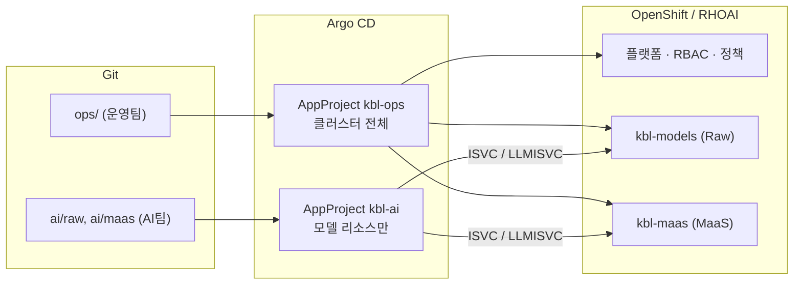
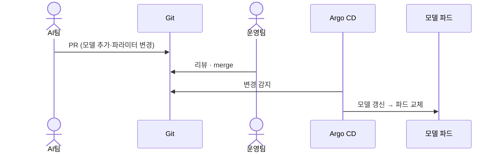

# KB Life AI 모델 서빙 GitOps — 요약

RHOAI 3.5 에서 LLM 을 **Raw(KServe RawDeployment)** 와 **MaaS(llm-d + Models-as-a-Service)** 두 방식으로 서빙한다.
상세 내용은 [README.md](README.md).

## 1. 컨셉

- **Git 이 유일한 변경 경로**: 커밋 → Argo CD 가 반영. 클러스터에서 직접 바꾼 것은 되돌린다(selfHeal)
- **폴더 = 책임**: `ops/` 운영팀, `ai/` AI팀 (나중에 리포로 분리 가능)
- **이중 가드**: Argo CD AppProject 가 AI팀이 배포할 수 있는 리소스를 모델(ISVC/LLMISVC)로 제한 + 클러스터 권한은 조회(view)만
- **용도별 서빙**: Raw = 클러스터 안 에이전트, SA 토큰 / MaaS = 클러스터 안팎, API 키 + 토큰 한도
- **digest 고정**: 이미지·모델은 `@sha256:`, 런타임 이름은 `vllm-<등급>-<버전>`
- **등급·출처는 라벨 + Nexus repo**: `kblife.co.kr/runtime-tier: ga|fast|community`, `kblife.co.kr/model-source: validated|community`.
  보증은 라벨이 아니라 repo push 권한



## 2. 폴더 구조

```
rhoai-serving-gitops/
├── ai/                    AI팀
│   ├── raw/               InferenceService (Raw)            → kbl-models
│   ├── maas/              LLMInferenceService (MaaS)        → kbl-maas
│   └── CATALOG.md         에이전트용 모델 목록 (자동 생성)
├── ops/                   운영팀
│   ├── gitops/            Argo CD AppProject, 앱 목록(app-of-apps)
│   ├── platform/          그룹(사용자), RBAC, HardwareProfile
│   ├── kbl-models/        Raw 네임스페이스: 격리 정책, vLLM 런타임, 호출 Role
│   ├── kbl-maas/          MaaS 네임스페이스: 격리 정책, vLLM 런타임, MaaS 게시
│   ├── maas-policy/       MaaS 구독(토큰 한도)·인가
│   ├── agent/             에이전트 네임스페이스 등록 (호출 권한 + 워크벤치)
│   └── mig/, network-isolation/
└── examples/              에이전트 호출 예시
```

## 3. 누가 무엇을 커밋하나

| 폴더 | 커밋하는 사람 | 리뷰·merge | 반영 (Argo CD 앱) |
|---|---|---|---|
| `ai/raw/`, `ai/maas/` | AI팀 (AI admin·AI 개발자) | 운영팀 | `kbl-ai-raw`, `kbl-ai-maas` — 자동 |
| `ops/kbl-models/`, `ops/kbl-maas/`, `ops/agent/`, `ops/maas-policy/` | 운영팀 | 운영팀 | `kbl-ops-*` — 자동 |
| `ops/platform/` | 운영팀 | 운영팀 | `kbl-ops-platform` — **수동 Sync** |
| `ops/gitops/appprojects.yaml` | 운영팀 | 운영팀 | Argo 가 관리하지 않음 → `oc apply` |



- AI팀이 운영팀에 요청하는 것: 새 vLLM 런타임, 에이전트 네임스페이스 등록, MaaS 공개·토큰 한도, GPU quota, 다른 네임스페이스 접근, 사용자 추가
- AI팀 폴더에 모델 외 리소스를 넣으면 Argo CD 가 동기화를 거부한다

## 4. 역할 (그룹)

| 그룹 | 역할 | 권한 |
|---|---|---|
| `kbl-ai-ops` | 운영팀 | `cluster-admin`, Argo CD `kbl-ops` 전체 |
| `kbl-ai-admins` | AI admin | developers 권한 + kbl-models playground + 프로젝트 생성 (클러스터 전체 view 없음) |
| `kbl-ai-developers` | AI 개발자 | RHOAI 프로젝트(kbl-models·kbl-maas·kai-agent·kbl-eval) view, 지정 프로젝트(`kai-agent`) 워크벤치, MaaS API 키 발급. 프로젝트 생성 불가 |

## 5. 모델 호출

| | Raw | MaaS |
|---|---|---|
| 주소 | `https://<모델>-predictor.kbl-models.svc:8443/v1` | `https://maas.<apps 도메인>/v1` |
| 인증 | 파드 자기 SA 토큰 (요청마다 파일에서 읽음) | API 키 `sk-oai-…` |
| 누가 | 운영팀이 등록한 네임스페이스(`ops/agent/<ns>.yaml`)만 | 구독 그룹 사용자 (어느 네임스페이스·클러스터 밖도 가능) |
| 사용량 제한 | 없음 | 사용자별 토큰 한도 |

## 6. 간단히 알아둘 것

- **변경 영향**: 모델 파일의 args·resources·이미지·런타임·라벨을 바꾸면 파드가 재기동된다 (Raw 는 `Recreate` 라 잠시 중단)
- **런타임**: 새 vLLM 버전은 기존 런타임 수정이 아니라 새 런타임 파일 추가. 모델을 하나씩 옮긴다
- **prune 꺼진 앱**(`kbl-ops-*`): 파일을 지우거나 이름을 바꿔도 예전 리소스가 남는다 → 확인 후 직접 삭제
- **모니터링**: RHOAI 대시보드 Models 탭은 AI팀도 보이고, LLM·Usage 탭은 관리자만 → AI팀은 OpenShift 콘솔 Observe → Metrics
- **MaaS 키 만료 상한**: `MaasTenantConfig spec.apiKeys.maxExpirationDays` (기본 90일, 현재 openshift-cluster-gitops 관리)
- **PoC 상태**: GPU 1장을 time-slicing 2개로 나눠 `qwen3-1-7b` 를 Raw(vLLM 0.28 community)·MaaS(vLLM 0.24 GA)로 동시 서빙
- **KB Life 적용 시**: Nexus digest, AD 그룹 동기화, 사내 Git 주소, DGX B300 GPU(MIG) — [README.md §12](README.md#12-kb-life-환경에-적용할-때-바꿀-값)
